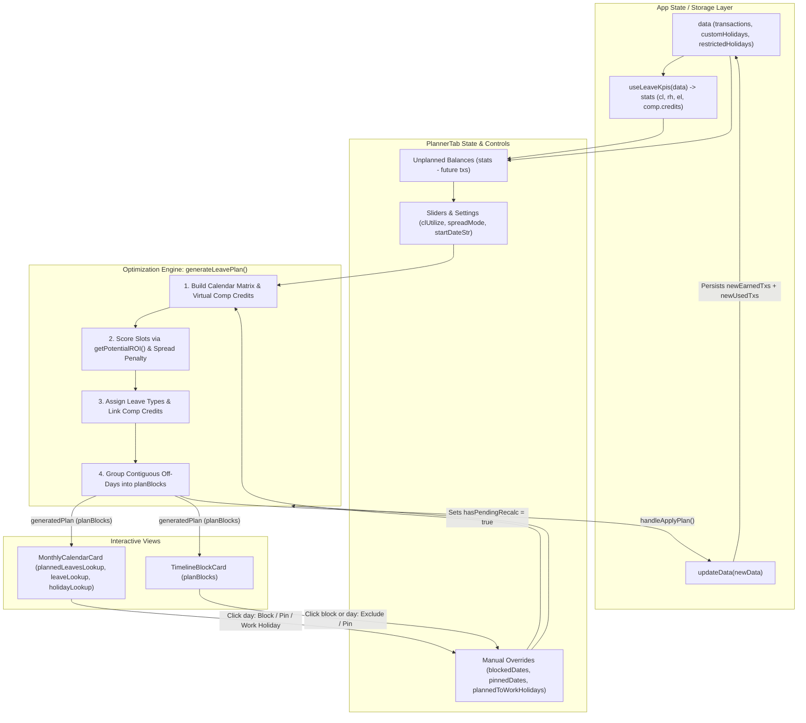
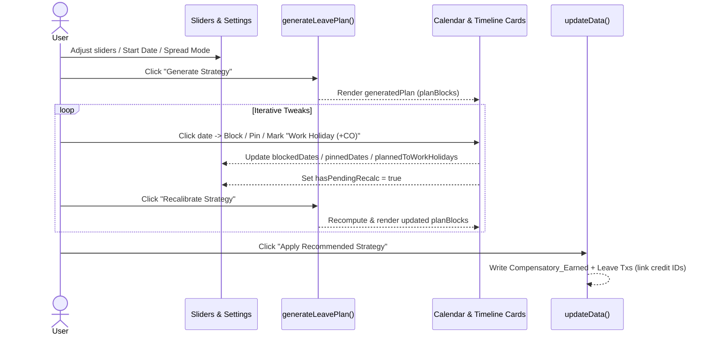

# Strategic Leave Planner — Architectural Blueprint

A complete architectural guide and data-flow specification for implementing an interactive, ROI-driven **Strategic Leave Planner** in a React-based Leave Manager application.

---

## 1. Recommended Module Structure

Separate the **pure optimization engine** from the **React UI** so the planning algorithm is framework-agnostic and easy to unit test:

```text
src/
├── planner/
│   ├── plannerEngine.js        # Pure JS: generateLeavePlan(), getPotentialROI(), block grouping
│   ├── plannerUtils.js         # getDaysInMonth() & calendar grid helpers
│   ├── PlannerTab.jsx          # State container, sliders/settings, Normal & Fullscreen layouts
│   ├── MonthlyCalendarCard.jsx # Month grid + floating day-configuration popover
│   ├── TimelineBlockCard.jsx   # Grouped "Continuous Days Off" block cards
│   └── CalendarLegendPanel.jsx # Color & status legend
└── utils/
    ├── dateUtils.js            # formatLocalDate (YYYY-MM-DD), toDMY, isSunday, isSecondSaturday
    └── logicUtils.js           # getHolidayName, getTransactionCategory
```

---

## 2. Data Contracts (Inputs & Outputs)

The planner is decoupled from persistence via three props: `stats`, `data`, and `updateData`.

### A. Input: `stats` (Leave Balances & Comp Off Credits)

```ts
interface PlannerStats {
  cl: { remaining: number };
  rh: { remaining: number };
  el: { balance: number };
  comp: {
    balance: number;
    credits: Array<{
      id: string | number;
      date: string;           // YYYY-MM-DD (earned date)
      remainingDays: number;
      expiryDate: string;     // YYYY-MM-DD (e.g., earnedDate + 180 days)
      isExpired: boolean;
    }>;
  };
}
```

> **Important:** Before feeding balances to the planner, subtract any **already-scheduled future leaves** (`t.date > todayStr`) from `stats` to get the true *unplanned* balance (`clRemaining`, `rhRemaining`, `compRemaining`, `elRemaining`).

### B. Input: `data` (Transactions & Holidays)

```ts
interface PlannerData {
  transactions: Array<{
    id: string | number;
    type: 'CL' | 'Deduction_CL' | 'RH' | 'EL_Used' | 'Compensatory_Earned' | 'Compensatory_Used' | string;
    days: number | string;
    date: string;             // YYYY-MM-DD
    linked_credit_id?: string | number | null;
    pending_confirmation?: boolean;
  }>;
  customHolidays: string[];               // ['YYYY-MM-DD', ...]
  holidayDetails: Record<string, string>; // { '2026-01-26': 'Republic Day' }
  restrictedHolidays: string[];           // ['YYYY-MM-DD', ...]
}
```

### C. Output: `updateData(newData)` (Persisting the Plan)

When the user clicks **Apply Recommended Strategy**, `handleApplyPlan` emits:
1. **`Compensatory_Earned` transactions** for every date in `plannedToWorkHolidays` (with `pending_confirmation: true`).
2. **Leave usage transactions** (`CL`, `RH`, `EL_Used`, `Compensatory_Used`), resolving any temporary `virtual-credit-<date>` IDs to the newly generated `Compensatory_Earned` transaction ID via `linked_credit_id`.

---

## 3. System Information Flow



---

## 4. Interactive Human-in-the-Loop Flow



---

## 5. Core Optimization Engine (`generateLeavePlan`)

The engine runs in **4 deterministic stages** over `[startDateStr, Dec 31]`:

### Stage 1: Calendar Matrix & Virtual Credits
1. **Calendar Map (`calendar[YYYY-MM-DD]`)**: Each day in `[planStart, Dec 31]` records:
   - `isWeekendOrHoliday`: `(isSunday || isSecondSaturday || isGovtHoliday) && !isWorkedHoliday`
   - `hasExistingLeave`: any non-credit transaction on that date
   - `isInitialDayOff`: `isWeekendOrHoliday || hasExistingLeave`
   - `isRestrictedHoliday`: in `restrictedHolidays` and not marked as worked
2. **Virtual Comp Credits**: Every date in `plannedToWorkHolidays` creates an in-memory credit (`id: "virtual-credit-${dateStr}"`) with a 180-day rolling expiry.
3. **Expiry Threshold Filter**: If `limitCompExpiry` is enabled, comp credits expiring more than `compExpiryThreshold` days after Dec 31st are excluded.
4. **Pinned Pre-Allocations**: Dates in `pinnedDates` with an explicit type (`CL`, `RH`, `EL_Used`, `Compensatory_Used`) are locked immediately; pinned Comp Offs consume the earliest-expiring eligible credit.

### Stage 2: Slot Selection & ROI Scoring (`getPotentialROI`)
For any candidate 1-day or 2-day window, count contiguous off-days immediately before (`countBefore`) and after (`countAfter`), then score:

| Mode / Tier | Condition | Score Formula |
| :--- | :--- | :--- |
| **Bridge: Tier 1** | 1-day sandwich gap (`countBefore >= 1 && countAfter >= 1`) | `25.0 + countBefore + countAfter` |
| **Bridge: Tier 2** | 1-day Mon or Fri adjacent to weekend/holiday | `15.0 + max(countBefore, countAfter)` |
| **Bridge: Tier 3** | Restricted Holiday adjacent to weekend/holiday | `+10.0` bonus |
| **Bridge: Tier 4** | 2-day sandwich bridge | `5.0 + countBefore + countAfter` |
| **Bridge: Regular / Isolated** | Other adjacent / isolated Tue–Thu | `0.1 * max(...)` / `-10.0` |
| **Mid-Week Mode** | `countBefore === 0 && countAfter === 0` | `5.0` (adjacent penalized to `0.1`) |

To distribute leaves across the year rather than clustering them in one month, apply a monthly spread penalty:

$$\text{adjustedRoi} = \text{rawRoi} - (\text{plannedInMonth} \times \text{penalty})$$

where `penalty` is `3.0` (`spreadMode === 'spread'`) or `1.5` (`spreadMode === 'balanced'`).

**Selection Order (`dates-first` default):**
1. Select best **RH** slots (`isRestrictedHoliday && !isInitialDayOff`).
2. Select best **Comp Off** slots, bounded by `c.dateStr >= startDateStr && c.dateStr <= credit.expiryDate` (using `penalty * 0.6`), tracking the mapping in `compSlotsByCredit`.
3. Greedily pick the highest-`adjustedRoi` 1-day or 2-day slots until `totalSlotsNeeded` is reached, falling back to `findFallbackSlot` (adjacent extensions first, then Mon/Fri workdays).

*(In `type-priority` mode, allocate RH first, then iterate `leaveTypePriority` such as `['Comp', 'CL', 'EL']`.)*

### Stage 3: Leave Type Allocation
1. Assign **RH** to selected `isRestrictedHoliday` slots (sorted by ROI).
2. Assign **Compensatory_Used** using `compSlotsByCredit` from Stage 2 so `linkedCreditId` always respects credit expiry bounds.
3. Assign **CL** and **EL_Used** to remaining untyped slots in priority order.
4. Cleanup pass: assign any remaining untyped slots within user-chosen slider quotas.

### Stage 4: Visual Block Grouping
For each planned date, trace backwards and forwards across contiguous `isInitialDayOff || !!plannedType` days to emit `planBlocks`:

```ts
interface PlanBlock {
  id: string;                 // First planned date in block
  startDate: string;          // YYYY-MM-DD
  endDate: string;            // YYYY-MM-DD
  totalDays: number;          // Total continuous days off (leaves + weekends + holidays)
  plannedLeaves: Array<{
    date: string;
    type: 'CL' | 'RH' | 'EL_Used' | 'Compensatory_Used';
    linkedCreditId: string | number | null;
  }>;
  dayDetails: Array<{
    dateStr: string;
    desc: string;             // e.g., "Planned CL", "Sunday", "Christmas"
    isPlannedLeave: boolean;
    plannedType: string | null;
    linkedCreditId: string | number | null;
  }>;
}
```

---

## 6. Interactive UI State Machine

`PlannerTab` maintains four interactive constraint states that let the user steer the optimizer:

| State | Type | Purpose |
| :--- | :--- | :--- |
| `clUtilize`, `rhUtilize`, `compUtilize`, `elUtilize` | `number \| null` | Sliders capping how many leaves of each type to schedule. |
| `blockedDates` | `Set<string>` | Workdays excluded from suggestions. |
| `pinnedDates` | `Record<string, LeaveType \| 'AUTO'>` | Dates locked to a specific leave type, or `'AUTO'` to force a leave and let the engine choose the type. |
| `plannedToWorkHolidays` | `Set<string>` | Weekends/holidays the user plans to work, generating virtual `+1 CO` credits. |

- Any modification sets `hasPendingRecalc = true`, surfacing a **Recalibrate Strategy** button so users can batch multiple calendar edits before re-running `generateLeavePlan()`.
- `MonthlyCalendarCard` renders a floating configuration popover on day click (with edge-aware positioning based on day-of-month and day-of-week).
- `TimelineBlockCard` renders each `PlanBlock` with per-block and per-day **Exclude** and **Pin/Unpin** actions.

---

## 7. Concrete Walkthrough Example

Suppose today is **2026-11-26**, `stats.cl.remaining = 3`, `1 CL` is already booked on `2026-12-04`, and `stats.comp.credits` has one credit (`id: 101`, `expiryDate: '2026-12-20'`).

1. **Unplanned Balance:** `clRemaining = 2`, `compRemaining = 1`.
2. **User Overrides:**
   - Marks **Dec 13 (Sun)** as *"Plan to Work (+Comp)"* → `plannedToWorkHolidays.add('2026-12-13')`.
   - Marks **Dec 24 (Thu)** as *"Lock Leave (Auto-Assign)"* → `pinnedDates['2026-12-24'] = 'AUTO'`.
3. **Engine Execution:**
   - Creates virtual credit `virtual-credit-2026-12-13` (expires `+180` days).
   - Evaluates **Dec 26 (Sat)** between Dec 24–25 (pinned + Christmas) and Dec 27 (Sun) → **Tier 1 Sandwich Bridge** (`rawRoi = 28`).
   - Allocates `Compensatory_Used` (`linkedCreditId: 101`) before Dec 20, `CL` on Dec 24, and `Compensatory_Used` (`linkedCreditId: 'virtual-credit-2026-12-13'`) on Dec 26.
   - Groups Dec 24–27 into a **4 Continuous Days Off** `PlanBlock`.
4. **Apply (`handleApplyPlan`):**
   - Creates `Compensatory_Earned` for `2026-12-13` (e.g., `id: 17957001`).
   - Replaces `'virtual-credit-2026-12-13'` with `17957001` on the `2026-12-26` `Compensatory_Used` transaction.
   - Calls `updateData({ ...data, transactions })`.

---

## 8. Porting Checklist for a New App

- **Parameterize Org Rules:** Extract `isSecondSaturday` and `COMP_EXPIRY_DAYS = 180` into a configurable rules object (e.g., `weekendDays: [0, 6]`, `compExpiryDays: 180`) if the target app has different weekend or expiry policies.
- **Use Local Date Strings Everywhere:** Always format dates with local year/month/day (`formatLocalDate`) rather than `toISOString().split('T')[0]` to prevent UTC timezone off-by-one bugs.
- **Unit Test the Engine First:** Because `generateLeavePlan()` is pure, test ROI scoring, credit expiry bounds, `pinnedDates`, `blockedDates`, and `plannedToWorkHolidays` in Vitest/Jest before wiring up the UI.
